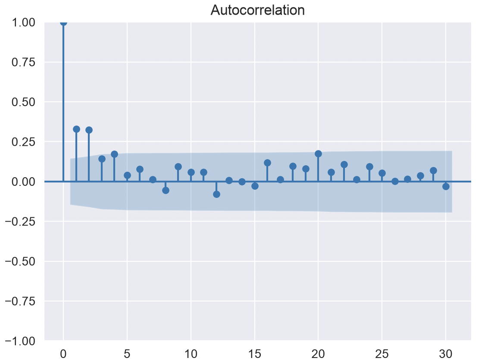
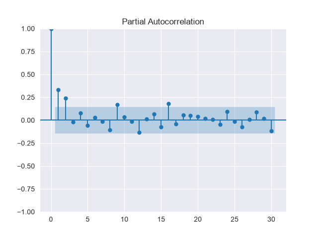
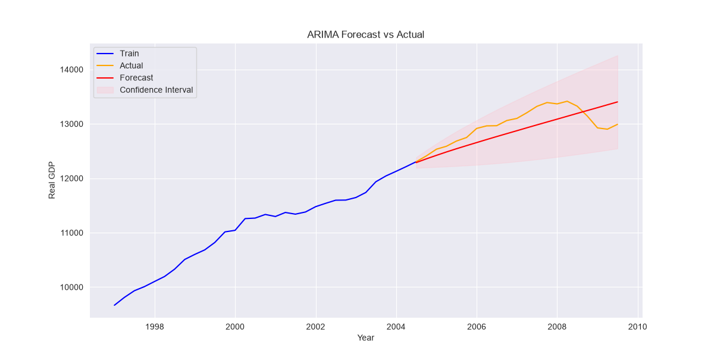
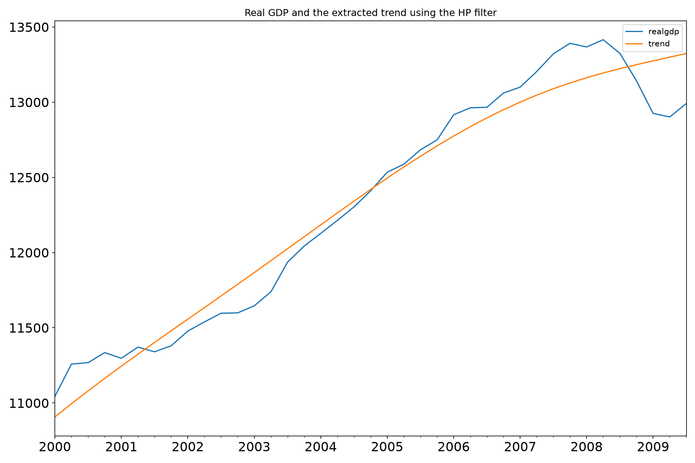
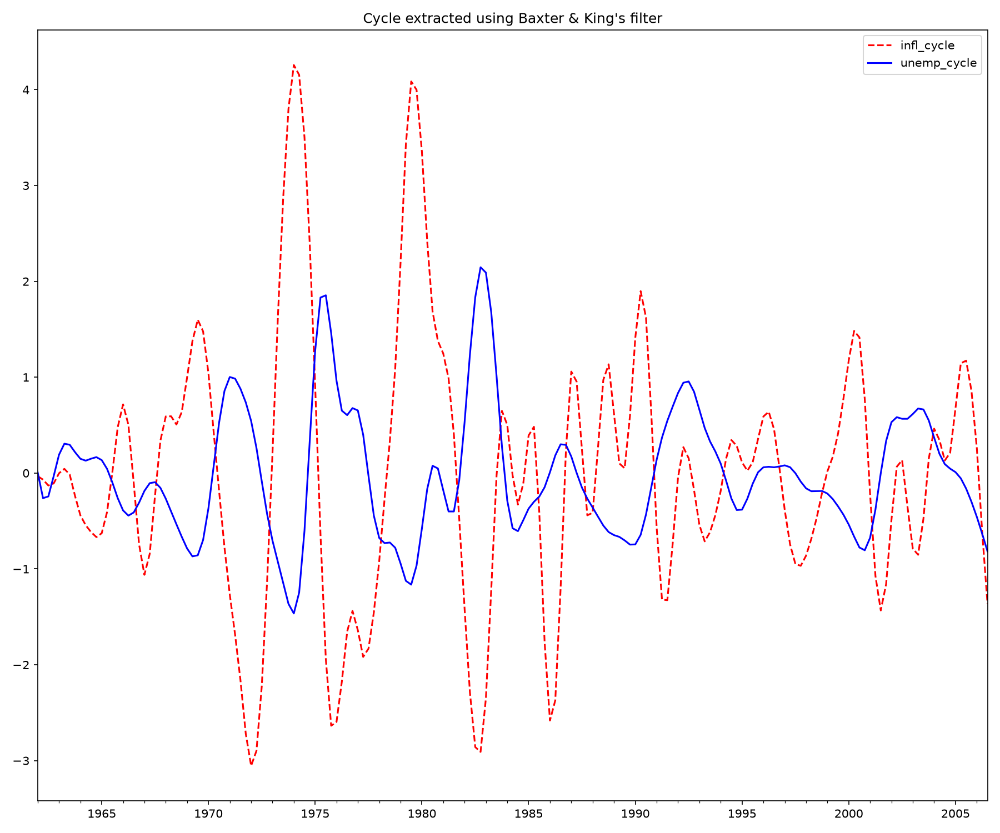
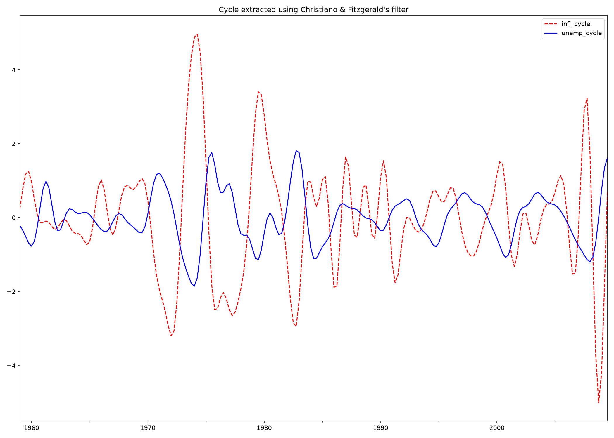
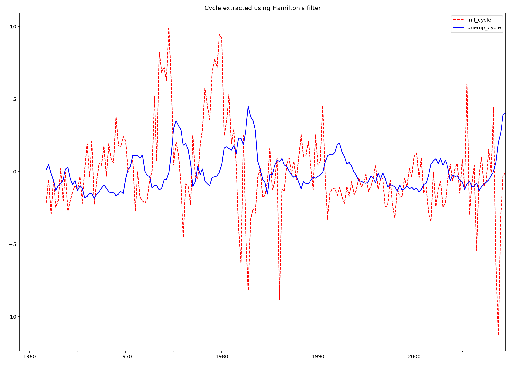

# Time Series Forecasting with ML

This note is to present time series analytics and neural network forecasting, from statistical baselines through recurrent networks, transformers, and time-series foundation models.

Time series refers to a sequence of data points indexed in a discrete-time order which are omnipresent in real world application. The semantic information of time series data is primarily derived from the temporal variation.

## 1. Core Foundations & Classical Analytics

The following traditional analytics methods have been instrumental in uncovering patterns, trends, and seasonality within temporal variations:

* [Autoregressive Integrated Moving Average (ARIMA)](https://www.statsmodels.org/stable/examples/notebooks/generated/autoregressive_integrated_moving_average.html) and [see below](#arima) also.
* [Exponential Smoothing](#exponential-smoothing)
* Spectral Analysis

Their rigid assumptions of linearity and stationarity limit their application to dynamic and evolving data flows. 

### ARIMA

The Three Components of: ARIMA(p, d, q)

* AR - Autoregressive (p): Uses a linear combination of previous time steps (lag observations) to predict the current value.
* I - Integrated (d): Applies differencing (subtracting an observation from its prior step) a number of d times to make a non-stationary time series stationary (constant mean and variance).
* MA - Moving Average (q): Incorporates past forecast errors (residuals) rather than past raw values to smooth out predictions.

To specify / find the values of (p,d,q) we can use Augmented Dickey-Fuller (ADF) test, autocorrelation (ACF) and partial autocorrelation (PACF) plots. The most efficient approach is to set up the simplest ARIMA configuration and eventually adding complexity by trial-and-errors. ACF and PACF are core statistical tools used to analyze time series data.

**ACF**, autocorrelation measures the linear relationship between a time series and a lagged version of itself. For example, ACF at lag 3 looks at how closely values today relate to values 3 time periods ago. ACF captures both direct and indirect effects. The following chart, plots the correlation coefficients for each time lag. If the ACF cuts off sharply after lag $q$, it suggests an MA($q$) signature.

<figure markdown="span">
{ width=500 }
</figure>

**PACF**, partial autocorrelation measures the relationship between a time series and a lagged version of itself while removing the intervening effects of the time steps in between. For instance, the PACF at lag 3 isolates the direct relationship between $y_t$ and $y_{t-3}$, stripping out whatever influence lags 1 and 2 had. It is used to determine the $p$ (autoregressive - AR) order in an ARIMA model

<figure markdown="span">
{ width=500 }
</figure>

* Blue region represents a 95% confidence interval
* Bars that extend outside this region are considered statistically significant, indicating that the correlation at that specific lag is unlikely to be due to random chance.
* Lag 0: Always starts at $1.0$ because a time series is perfectly correlated with itself at zero lag.

* Both ACF and PACF show significant spikes at the first few lags, suggesting the presence of a short-term correlation. Altogether, the plots highlighting a time-series with an initial correlation that lose importance after the very first few lags.

ARIMA assumes linear relationships and may struggle with structural breaks or non-linear dynamics

See [time-series/arima_tutorial.py](https://github.com/jbcodeforce/ML-studies/tree/main/code/time-series/arima_tutorial.py) which illustrates GDP predictions from 203 existing observations, and how the model captures the real-GDP upward trend reasonably well. However, it fails in catching some short-term fluctuations along with some temporal dynamics.

<figure markdown="span">

</figure>

To assess the quality, it uses the RMSE, Root Mean Square Error: to measure the accuracy of a model, particularly in regression and time series forecasting. It measures how far off the model's predictions are from the actual observed data. An RMSE of $0$ means the model makes zero errors and fits the data perfectly

\({RMSE} = \sqrt{ \frac{1}{n} \sum_{i=1}^{n} (y_i - \hat{y}_i)^2 }\)

```
Where:
n = number of observations
Σ = sum from $i = 1$ to $n$
y_i = actual value
y_hat_i = predicted value
```

To run the code study:
```sh
cd code/time-series 
uv run arima_tutorial.py 
```

### Time-series Filtering

The [tsa_filter.py](https://github.com/jbcodeforce/ML-studies/tree/main/code/time-series/tsa_filter.py) script demonstrates four popular time-series filtering methods from statsmodels:

#### Hodrick-Prescott (HP) filter: 
It is a mathematical technique used in macroeconomics and time series analysis to decompose a time series into a smooth, long-term trend and a short-term cyclical component.

<figure markdown="span">
{ width=500 }
</figure>

???+ info "Hodrick-Prescott"
    When looking at economic data like GDP, unemployment, or inflation, the raw data bounces around due to short-term business cycles, seasonal quirks, or shocks, while simultaneously growing or shifting over the long run. The HP filter helps economists isolate the "cycle" from the "trend."

    Given an original time series:
    
    \[
        y_t (for\ periods\ t = 1, 2, \dots, T)
    \]
    
    the HP filter assumes the series is the sum of two components:
    
    \[
    y_t = \tau_t + c_t
    \]
    
    
    * $\tau_t$ = the trend component (the underlying long-term growth path)
    * $c_t$ = the cyclical component (short-term fluctuations around the trend)
    
    The Optimization Problem:
    The filter finds the trend series $\tau_t$ by solving an optimization problem that balances two conflicting goals: fitting the data closely versus keeping the trend smooth.
    
    Mathematically, it minimizes the following equation:

    \[
    \min_{\tau} \sum_{t=1}^{T} (y_t - \tau_t)^2 + \lambda \sum_{t=2}^{T-1} [(\tau_{t+1} - \tau_t) - (\tau_t - \tau_{t-1})]^2
    \]

    This formula consists of two parts:
    
    1. The Fit Term ($\sum (y_t - \tau_t)^2$): This penalizes the distance between the actual data $y_t$ and the trend $\tau_t$. If $\lambda = 0$, the trend would just equal the original data.
    1. The Penalty Term ($\lambda \sum [(\tau_{t+1} - \tau_t) - (\tau_t - \tau_{t-1})]^2$): This measures the acceleration (change in the growth rate) of the trend. It penalizes sharp, abrupt turns in the trendline, forcing it to remain smooth.
    
    The Smoothing Parameter ($\lambda$):
    
    $\lambda$ (lambda) controls how smooth the trend will be.
    * A larger $\lambda$ forces the trend to be smoother and straighter (ignoring short-term swings).
    * A smaller $\lambda$ allows the trend to bend and follow the actual data more tightly.
    
    Standard conventions for $\lambda$ based on data frequency (first popularized by Hodrick and Prescott in 1997) are:
    * Quarterly data: $\lambda = 1,600$ (the most common standard in macroeconomics)
    * Annual data: $\lambda = 6.25$ (or sometimes $100$)
    * Monthly data: $\lambda = 14,400$

    Because the filter looks both backward and forward to calculate the trend, it tends to be unstable and heavily biased at the very beginning and very end of a dataset.

#### Baxter-King (BK) approximate band-pass filter

The Baxter-King filter is a band-pass filter. Its goal is to strip out both high-frequency "noise" (very short-term fluctuations, like monthly weather or seasonal quirks) and low-frequency "trends" (long-term secular growth), leaving behind only the medium-term movements—typically defined as the business cycle. Robert King and Stuart Baxter (1999) developed a practical approximation using a moving average. 

Mathematically, the filtered cyclical series $c_t$ is constructed as a weighted sum of the original series $y_t$ over a symmetric window of leads and lags:

\[
c_t = \sum_{j=-K}^{K} a_j y_{t-j}
\]

Where:

* $K$ is the truncation length (how many periods backward and forward the filter looks).
* $a_j$ are the moving average weights, mathematically derived to isolate the desired frequency band (e.g., 6 to 32 quarters for quarterly data).
* The weights sum to zero, which ensures that any unit root (non-stationary trend) in the original data is removed, making the resulting cyclical component stationary.

By applying the band-pass filter to a series, the [algorithm])(https://www.statsmodels.org/stable/examples/notebooks/generated/tsa_filters.html) produces a new series that does not contain fluctuations at higher or lower than those of the business cycle.

The following curve comes from the above code execution of Inflation & Unemployment, to explore the hypothesis that inflation and unemployment are counter-cyclical.

<figure markdown="span">
{ width=500 }
</figure>

#### Christiano-Fitzgerald (CF) approximate band-pass filter.

The Christiano-Fitzgerald filter is a generalization of BK and can thus also be seen as weighted moving average. However, the CF filter is asymmetric about 𝑡 as well as using the entire series. 

<figure markdown="span">
{ width=500 }
</figure>

#### Hamilton filter

The Hamilton filter is based on the idea that the cyclical component can be estimated by regressing the series on its own lags and then taking the residuals as the cyclical component. This method does not require any assumptions about the frequency of the cycle or the smoothness of the trend, making it more flexible than traditional filters. 

The underling AR model estimated is

\[
𝑦𝑡+ℎ=𝛼0+𝛼1⁢𝑦𝑡+𝛼2⁢𝑦𝑡−1+⋯+𝛼𝑝⁢𝑦𝑡−𝑝+1+𝑣𝑡+ℎ
\]

The recommendations are h=8, p=4 for quarterly data and h=24, p=12 for monthly data. The Hamilton filter fills the first 
𝑝 +ℎ −1 places with NaN since there is no data available to estimate the AR in these positions

<figure markdown="span">
{ width=500 }
</figure>

### [Exponential Smoothing](https://www.statsmodels.org/stable/examples/notebooks/generated/exponential_smoothing.html)

Forecasting methods assigning exponentially decreasing weights to past observations: recent data has a much higher impact on the forecast than older data.

Exponential Smoothing focuses entirely on splitting a time series into its core components: Level, Trend, and Seasonality.

* [Code example: time-series/expo_smoothing.py](https://github.com/jbcodeforce/ML-studies/tree/main/code/time-series/expo_smoothing.py) to demonstrate simple exponential smoothing on oil production, 
    ```python
    fit3 = SimpleExpSmoothing(oildata, initialization_method="estimated").fit()
    fcast3 = fit3.forecast(3).rename(
        r"$\alpha={}$".format(fit3.model.params["smoothing_level"])
    )
    plt.plot(fit3.fittedvalues, marker="o", color="green")
    ```
#### Sources

* [Exponential Smoothing for Time Series Forecasting in Python](https://machinelearningmastery.com/exponential-smoothing-for-time-series-forecasting-in-python/)
* [Statsmodels - Exponential Smoothing](https://www.statsmodels.org/stable/examples/notebooks/generated/exponential_smoothing.html)

### Deep learning

In general neural networks often overfit when applied naively to series where a simple statistical baseline or tree-based model would perform better. The following techniques should be considered:

* Decomposition & Stationarity: Deconstruct series into trend, seasonality, and residual components (additive vs. multiplicative). Test for unit roots using the Augmented Dickey-Fuller (ADF) test or KPSS test to determine whether differencing or log transforms are needed.
* Autocorrelation Analysis: Plot Auto-Correlation Functions (ACF) and Partial Auto-Correlation Functions (PACF) to identify autoregressive and moving average properties, which also determine your lookback window length ($p$).
* Baseline Benchmarks: Always evaluate deep models against a naive drift, Seasonal Naive, Exponential Smoothing (Holt-Winters), and SARIMAX.
* Tree-Based Feature Engineering: Gradient-boosted decision trees (LightGBM, XGBoost, CatBoost) with engineered lag features, rolling statistics (mean, standard deviation over 7/14/30 days), and calendar Fourier terms frequently match or outperform neural networks on tabular time series.

## 2. Neural Network Architectures for Forecasting

Deep learning excels primarily when dealing with high-dimensional multivariate series, non-linear cross-series dependencies, long lookback horizons, or cold-start scenarios where one global model trains across thousands of interrelated time series.

| Architecture | Representative Models | Primary Strengths | Best Use Cases |
| --- | --- | --- | --- |
| Recurrent (RNNs) | LSTM, GRU, xLSTM | Explicit sequential memory states; natural handling of step-by-step inputs | Sensor telemetry, medium-horizon univariate/multivariate series |
| Convolutional (CNNs) | Temporal Convolutional Networks (TCN) | Dilated causal 1D convolutions; parallelizable training; no vanishing gradients | Multi-scale temporal patterns with large historical windows |
| Decomposition MLPs | N-BEATS, N-HiTS | Extremely fast; interpretable trend/seasonality outputs; no recurrent loops | Fast univariate forecasting across millions of series |
| Transformer-Based | PatchTST, iTransformer, Informer | Tokenizes time patches rather than single steps; extracts long-range correlations | Long-horizon multivariate forecasting with complex cross-series signals |
| Zero-Shot Foundation Models | Chronos (T5-based), TimesFM, Lag-Llama | Pre-trained across open time series; zero-shot and few-shot inference | Rapid baseline generation and cold-start datasets |

## 3. Validation Strategy & Practical Toolstack

Time series data violates the standard machine learning assumption of independent and identically distributed samples. Rigorous evaluation requires temporal discipline.

1. Strict Temporal Splitting: 
Never use random train/test splits or standard $K$-fold cross-validation, as they introduce severe lookahead bias (data leakage). Use rolling-origin cross-validation (expanding or sliding windows).
1. Scaler Hygiene: When applying MinMax or Standard scaling, fit the scaler only on the training window and transform the test window using those fitted parameters.
1. Loss Functions & Metrics:
    * Point Forecasts: Use Mean Absolute Error (MAE) for robustness against outliers, Root Mean Squared Error (RMSE) to penalize large deviations, and Weighted Absolute Percentage Error (WAPE) for intermittent or zero-heavy series
    * Probabilistic Forecasts: Train models with Quantile Loss (pinball loss) to output prediction intervals ($p_{10}, p_{50}, p_{90}$) instead of a single deterministic number.
1. Core Python Ecosystem:
    * Data Handling & EDA: pandas, polars, statsmodels.
    * Unified Modeling Frameworks: Darts (covers ARIMA to PyTorch Transformers under an intuitive Scikit-Learn API) and Nixtla NeuralForecast (scalable implementations of N-BEATS, PatchTST, and TimesFM).
    * Deep Learning Frameworks: PyTorch and PyTorch Lightning for custom sequence-to-sequence or encoder-decoder architectures.
    
To see a hands-on implementation of recurrent networks for sequential prediction, see the [RNN and LSTM Time Series Forecasting Tutorial](https://www.youtube.com/watch?v=S8tpSG6Q2H0&t=6s). It provides a practical walk-through of structuring sliding window tensors and training recurrent models on sequential data using Python.